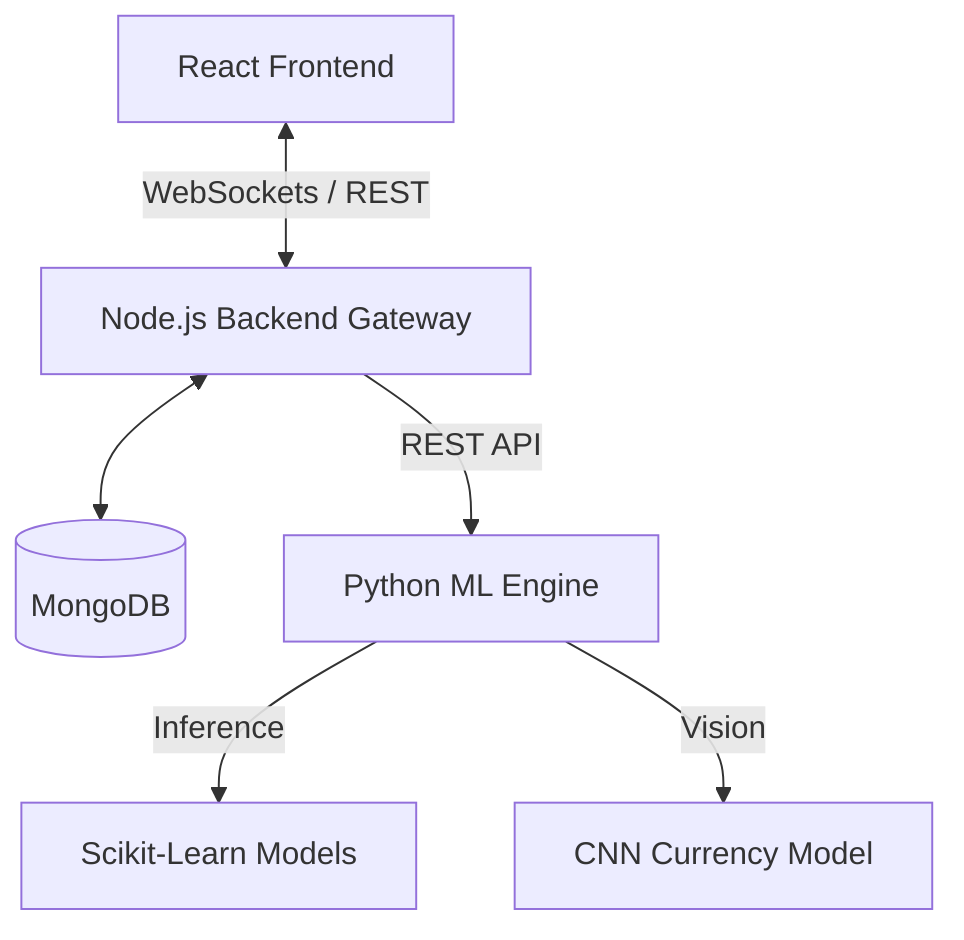

# 🛡️ Unified Financial Fraud Detection System
 
**Unified Financial Fraud Detection System** is a production-grade, microservices-based platform designed for real-time monitoring and predictive analysis of financial transactions. It leverages Machine Learning (Random Forest/SVM) to detect fraudulent patterns in UPI and Credit Card transactions, combined with a Computer Vision module for counterfeit currency detection.

---

## 🚀 Features

### 1. **Real-Time Transaction Monitoring**
- Live dashboard with WebSocket integration (Socket.io).
- Instant risk scoring and visualization using Recharts.
- Animated alert stream for immediate security response.

### 2. **Transaction ID Verification**
- Secure lookup of historical or live transactions by ID.
- Pulls full behavioral data (Location, Amount, Velocity) from MongoDB.
- ML-driven analysis with explainable "Risk Factors".

### 3. **Vision Module (Fake Currency Detection)**
- CNN-based image analysis for banknote authenticity.
- High-resolution scan interface with security feature checks (Watermark, Intaglio).

### 4. **Professional Command Center**
- Glassmorphic UI/UX designed for security operation centers.
- Dark mode optimized for long-duration monitoring.
- Responsive design for cross-device accessibility.

---

## 🏗️ Architecture

The system follows a **Microservices Architecture** to ensure scalability and separation of concerns:



---

## 🛠️ Tech Stack

- **Frontend:** React 18, Vite, Tailwind CSS, Lucide Icons, Recharts, Socket.io-client.
- **Backend:** Node.js, Express, Mongoose, Socket.io, Axios.
- **ML Service:** Python 3.x, Flask, NumPy, Scikit-Learn, Flask-CORS.
- **Database:** MongoDB (Persistent storage for transaction history).

---

## 📥 Installation & Setup

### 1. Prerequisites
- [Node.js](https://nodejs.org/) (v16+)
- [Python 3.9+](https://www.python.org/)
- [MongoDB](https://www.mongodb.com/try/download/community) (Running locally on port 27017)

### 2. Clone and Setup Backend
```bash
cd backend
npm install
npm run dev
```
*Runs on `http://localhost:5000`*

### 3. Setup ML Service
```bash
cd ml_service
pip install -r requirements.txt
python app.py
```
*Runs on `http://localhost:8000`*

### 4. Setup Frontend
```bash
cd frontend
npm install
npm run dev
```
*Runs on `http://localhost:5173`*

---

## 📊 API Documentation

### Backend Gateway (`:5000`)
| Method | Endpoint | Description |
|--------|----------|-------------|
| `POST` | `/api/v1/transactions/analyze` | Processes a transaction (ID or payload) through ML. |
| `GET`  | `/api/v1/transactions/:id` | Retrieves a specific transaction by ID. |

### ML Engine (`:8000`)
| Method | Endpoint | Description |
|--------|----------|-------------|
| `POST` | `/predict` | Receives raw features and returns fraud probability. |
| `GET`  | `/`        | Health check. |

---

## 📂 Project Structure

```text
Fraud-Detection-Project/
├── frontend/             # React (Vite) Application
│   ├── src/components/   # Dashboard & UI Modules
│   └── src/index.css     # Global Styles (Tailwind)
├── backend/              # Node.js API Gateway
│   ├── models/           # Mongoose Schemas
│   └── routes/           # Transaction Logic
└── ml_service/           # Python Flask ML Engine
    └── app.py            # Inference Logic
```

---

## 🛡️ Security & Performance
- **WebSocket Throttling:** Optimized broadcast frequency for high-concurrency feeds.
- **ML Fallback:** Graceful degradation to heuristic analysis if the ML service is unreachable.
- **Data Integrity:** Mongoose validation for all incoming financial records.

---

**Developed for Advanced Financial Security Monitoring.**
