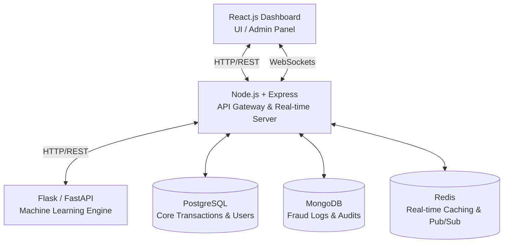

# Unified Financial Fraud Detection System
## Complete Architecture & Implementation Guide

This document outlines the end-to-end design for a highly scalable, real-time enterprise fraud detection platform. It incorporates modern tech stacks, high-performance machine learning serving, and a premium "fintech-grade" user interface.

---

## 1. System Architecture

The system utilizes a **Microservices Architecture** to separate user-facing logic from heavy machine learning computations.



**Data Flow Overview:**
1. A transaction enters the system via the Dashboard (manual) or an external webhook.
2. The Node.js backend receives it, does preliminary validation, and caches it in Redis.
3. Node.js forwards the parsed features to the Flask ML Service.
4. Flask runs inference (RF, SVM, etc.) and returns the `risk_score` and `decision`.
5. Node.js logs the result in PostgreSQL (ACID) and MongoDB (Log flexibility).
6. Node.js broadcasts the result via WebSockets back to the React UI for instant rendering.

---

## 2. Tech Stack Justification

| Layer | Technology | Justification |
| :--- | :--- | :--- |
| **Frontend** | React.js, Tailwind CSS | **React** allows building highly modular, reusable components for complex dashboards. **Tailwind CSS** enables rapid styling of a premium, dark-mode, glassmorphic UI without bloated CSS files. |
| **Charts/UI** | Recharts, Framer Motion | **Recharts** is highly customizable for real-time data visualization. **Framer Motion** adds buttery-smooth micro-animations, critical for the "premium" feel. |
| **Backend** | Node.js (Express) | Unmatched for handling thousands of concurrent I/O operations and WebSocket connections natively, making it perfect for real-time streaming. |
| **ML Engine** | Flask (Python) | Python is the industry standard for ML. Flask provides a lightweight, highly performant wrapper to serve `scikit-learn` and `TensorFlow`/`PyTorch` models as REST APIs. |
| **WebSockets** | Socket.io | Enables bi-directional real-time communication between the Node server and the React dashboard for instant fraud alerts. |

---

## 3. Database Decision: Hybrid Approach

For a production-level financial system, a single database paradigm is rarely sufficient. A **Hybrid Database Architecture** is recommended:

1. **PostgreSQL (Primary Relational DB)**
   - **Use Case:** User accounts, core transaction ledgers, merchant details.
   - **Why:** Financial data requires strict ACID compliance. You cannot afford lost or partially written transactions.
2. **MongoDB (NoSQL Document Store)**
   - **Use Case:** Fraud analysis logs, ML prediction metadata, unstructured payload storage (e.g., varying device fingerprint data).
   - **Why:** High write-throughput and schema flexibility. Different transaction types (UPI vs. Credit Card) have different shapes.
3. **Redis (In-Memory Data Store)**
   - **Use Case:** Rate limiting, real-time session storage, caching frequent queries, WebSocket Pub/Sub.

---

## 4. Machine Learning Pipeline

### Models Used
- **Random Forest:** The primary classifier. Excellent for tabular data, handles non-linear relationships easily, and critically, provides **Feature Importance** (Explainable AI - showing *why* a transaction was flagged).
- **SVM:** Used as a secondary verifier for high-margin, complex boundary cases.
- **AdaBoost:** Focuses on instances the previous models struggle with, providing an ensemble boost to recall metrics.
- **CNN (Fake Currency):** A Convolutional Neural Network (e.g., fine-tuned ResNet50) trained to detect microscopic anomalies in uploaded currency images.

### Feature Engineering
Before hitting the model, the data pipeline processes:
- `amount_zscore`: How far the transaction amount deviates from the user's historical average.
- `distance_from_home`: Haversine distance between the transaction IP location and user's registered zip code.
- `time_risk`: Flags transactions occurring between 2 AM - 5 AM local time.
- `velocity`: Number of transactions attempted by the same card/UPI in the last 10 minutes.

---

## 5. UI/UX Design

The dashboard must project an elite, command-center aesthetic.
- **Theme:** Deep Dark Mode (Background: `#0f172a`, Panels: `#1e293b` with 10% opacity + backdrop blur).
- **Accents:** Emerald Green (Genuine), Neon Crimson (Fraud), Amber (Suspicious).

### Layout Wireframe
```text
+---------------------------------------------------------------+
|  [Logo] Unified Financial Fraud Detection System      Search...      [Bell (3)] [Admin] |
+-----------+---------------------------------------------------+
| > Dash    |  [ KPI 1: Vol ]  [ KPI 2: Blocked ]  [ KPI 3: $ ] |
| > CC/DC   |                                                   |
| > UPI     |  +-----------------------+  +------------------+  |
| > Vision  |  |                       |  | Live Alerts (WS) |  |
| > Reports |  |  Real-time Flow Chart |  | > $4,000 TXN ... |  |
| > Config  |  |  (Recharts)           |  | > IP Mismatch... |  |
|           |  +-----------------------+  +------------------+  |
|           |                                                   |
|           |  +---------------------------------------------+  |
|           |  | Unified Transaction Stream (Data Grid)      |  |
|           |  | ID | Type | Amount | Risk Score | Action    |  |
|           |  +---------------------------------------------+  |
+-----------+---------------------------------------------------+
```

---

## 6. API Design

### Node.js Gateway
- `POST /api/v1/transactions/analyze`: Submit a transaction for synchronous analysis.
- `GET /api/v1/transactions/stream`: SSE or WS endpoint to subscribe to live feeds.
- `GET /api/v1/analytics/overview`: Fetch aggregated metrics for the dashboard.

### Flask ML Service (Internal VPC Only)
- `POST /predict/transaction`
  - **Body:** `{ "amount": 500, "distance": 120, "time_hour": 3, "velocity": 4 }`
  - **Response:** `{ "is_fraud": true, "confidence": 0.92, "top_reasons": ["distance", "time_hour"] }`
- `POST /predict/currency`
  - **Body:** `multipart/form-data` (Image file)
  - **Response:** `{ "is_fake": false, "confidence": 0.99 }`

---

## 7. Code Samples

### A. React.js: Real-Time Dashboard Component (Tailwind + WebSockets)
```javascript
import React, { useEffect, useState } from 'react';
import { io } from 'socket.io-client';
import { LineChart, Line, XAxis, Tooltip, ResponsiveContainer } from 'recharts';

const socket = io('http://localhost:5000');

export default function Dashboard() {
  const [liveTransactions, setLiveTransactions] = useState([]);
  const [chartData, setChartData] = useState([]);

  useEffect(() => {
    // Listen for real-time predictions
    socket.on('transaction_processed', (data) => {
      setLiveTransactions((prev) => [data, ...prev].slice(0, 10)); // Keep last 10
      setChartData((prev) => [...prev, { time: new Date().toLocaleTimeString(), score: data.risk_score }].slice(-20));
    });
    return () => socket.off('transaction_processed');
  }, []);

  return (
    <div className="min-h-screen bg-slate-900 text-white p-6 font-sans">
      <header className="mb-8">
        <h1 className="text-3xl font-bold bg-clip-text text-transparent bg-gradient-to-r from-blue-400 to-emerald-400">
          Unified Financial Fraud Detection System
        </h1>
      </header>

      <div className="grid grid-cols-1 lg:grid-cols-3 gap-6">
        {/* Chart Section */}
        <div className="col-span-2 bg-slate-800/50 backdrop-blur-md p-6 rounded-2xl border border-slate-700 shadow-xl">
          <h2 className="text-xl font-semibold mb-4 text-slate-200">Live Risk Heatmap</h2>
          <div className="h-64">
            <ResponsiveContainer width="100%" height="100%">
              <LineChart data={chartData}>
                <XAxis dataKey="time" stroke="#64748b" />
                <Tooltip contentStyle={{ backgroundColor: '#1e293b', borderColor: '#334155' }} />
                <Line type="monotone" dataKey="score" stroke="#f43f5e" strokeWidth={3} dot={false} />
              </LineChart>
            </ResponsiveContainer>
          </div>
        </div>

        {/* Live Feed Section */}
        <div className="bg-slate-800/50 backdrop-blur-md p-6 rounded-2xl border border-slate-700 shadow-xl overflow-hidden">
          <h2 className="text-xl font-semibold mb-4 text-slate-200">Live Alert Stream</h2>
          <div className="space-y-3">
            {liveTransactions.map((tx, idx) => (
              <div key={idx} className={`p-4 rounded-xl border ${tx.is_fraud ? 'bg-rose-500/10 border-rose-500/50' : 'bg-emerald-500/10 border-emerald-500/50'} transition-all`}>
                <div className="flex justify-between items-center">
                  <span className="font-mono text-sm">{tx.tx_id.substring(0,8)}</span>
                  <span className={`px-2 py-1 rounded text-xs font-bold ${tx.is_fraud ? 'bg-rose-500 text-white' : 'bg-emerald-500 text-white'}`}>
                    {tx.is_fraud ? 'FRAUD' : 'CLEAR'}
                  </span>
                </div>
                <div className="mt-2 text-sm text-slate-400">
                  Risk Score: <span className="text-white font-bold">{(tx.risk_score * 100).toFixed(1)}%</span>
                </div>
              </div>
            ))}
          </div>
        </div>
      </div>
    </div>
  );
}
```

### B. Node.js: Express API & WebSocket Gateway
```javascript
const express = require('express');
const axios = require('axios');
const http = require('http');
const { Server } = require('socket.io');

const app = express();
const server = http.createServer(app);
const io = new Server(server, { cors: { origin: '*' } });

app.use(express.json());

// Main Transaction Entry Point
app.post('/api/v1/analyze', async (req, res) => {
  try {
    const transactionData = req.body;
    
    // 1. Forward to Python ML Service
    const mlResponse = await axios.post('http://localhost:8000/predict', transactionData);
    const { is_fraud, risk_score, top_reasons } = mlResponse.data;

    const enrichedTransaction = {
      ...transactionData,
      is_fraud,
      risk_score,
      reasons: top_reasons,
      analyzed_at: new Date()
    };

    // 2. Save to Database (MongoDB example logic omitted for brevity)
    // await TransactionModel.create(enrichedTransaction);

    // 3. Emit via WebSockets to Dashboard
    io.emit('transaction_processed', enrichedTransaction);

    res.status(200).json({ success: true, data: enrichedTransaction });
  } catch (error) {
    res.status(500).json({ error: 'Analysis failed' });
  }
});

server.listen(5000, () => console.log('Node Gateway running on port 5000'));
```

### C. Flask: Machine Learning Prediction API
```python
from flask import Flask, request, jsonify
import joblib
import numpy as np

app = Flask(__name__)

# Load pre-trained Random Forest model
# model = joblib.load('models/random_forest_fraud.pkl')

@app.route('/predict', methods=['POST'])
def predict():
    data = request.json
    
    # Feature extraction (Mocked for example)
    # Expected: [amount, dist_from_home, time_hour, velocity]
    features = np.array([[
        data.get('amount', 0),
        data.get('distance', 0),
        data.get('time_hour', 12),
        data.get('velocity', 1)
    ]])
    
    # Mocking Prediction Logic (Replace with model.predict_proba)
    # prob = model.predict_proba(features)[0][1]
    
    # Simulation based on high amount & distance
    prob = 0.85 if (data.get('amount', 0) > 1000 and data.get('distance', 0) > 50) else 0.05
    
    is_fraud = bool(prob > 0.70)
    
    # Explainable AI subset
    reasons = []
    if data.get('amount', 0) > 1000: reasons.append("Unusually high amount")
    if data.get('distance', 0) > 50: reasons.append("Geo-location anomaly")

    return jsonify({
        "is_fraud": is_fraud,
        "risk_score": prob,
        "top_reasons": reasons if is_fraud else []
    })

if __name__ == '__main__':
    app.run(port=8000, debug=True)
```

### D. MongoDB: Transaction Schema (Mongoose)
```javascript
const mongoose = require('mongoose');

const TransactionSchema = new mongoose.Schema({
  tx_id: { type: String, required: true, unique: true },
  type: { type: String, enum: ['CREDIT_CARD', 'UPI', 'DEBIT_CARD'], required: true },
  amount: { type: Number, required: true },
  user_id: { type: String, required: true },
  timestamp: { type: Date, default: Date.now },
  device_ip: { type: String },
  location: {
    lat: Number,
    lng: Number
  },
  analysis: {
    is_fraud: { type: Boolean, required: true },
    risk_score: { type: Number, required: true },
    flagged_reasons: [String]
  }
});

module.exports = mongoose.model('Transaction', TransactionSchema);
```

---

## 8. Deployment Strategy

For a scalable, production-ready system:

1. **Dockerization:**
   - Create `Dockerfile`s for React, Node, and Flask apps.
   - Use `docker-compose.yml` to orchestrate local development (including pulling Postgres/Mongo images).
2. **Cloud Hosting (AWS):**
   - **Frontend:** Deployed to AWS S3 + CloudFront (or Vercel for ease of use).
   - **Backend & ML Services:** Hosted on AWS ECS (Elastic Container Service) or EKS (Kubernetes) to allow the Flask ML models to auto-scale independently during high transaction volumes.
   - **Databases:** AWS RDS for PostgreSQL and MongoDB Atlas.
3. **Security:**
   - ML API is strictly placed in a Private Subnet (VPC), only accessible by the Node.js API Gateway.
   - Rate limiting implemented on the Node.js API using Redis.
   - JWT-based Role-Based Access Control (RBAC) to ensure only Admins can view the dashboard.
